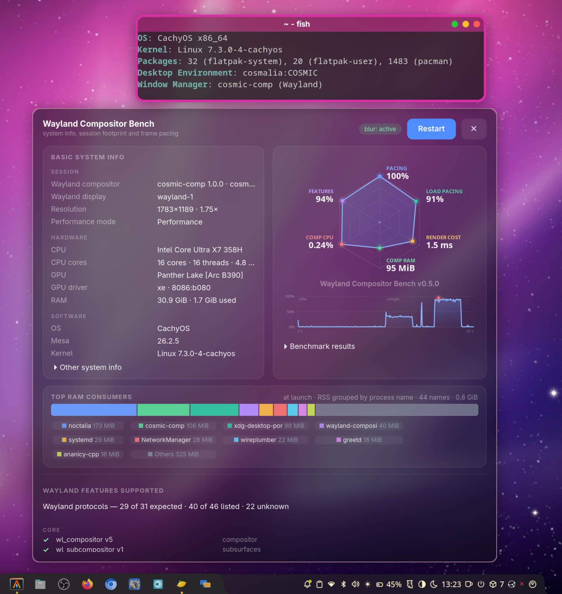

# Cosmalia - Modern Minimal Linux Desktop in < 1Gb RAM



Cosmalia is a modern, minimal desktop for Linux that runs in under 1 GB of
RAM. It is built from two projects:

- **[cosmic-comp-traffic](https://github.com/grigio/cosmic-comp-traffic)** — an
  improved fork of `cosmic-comp` with macOS-style traffic-light decorations,
  Wayland blur, animations, `zwlr_foreign_toplevel_manager_v1`, 3-finger
  workspace swipes and in-process Alt+Tab;
- **[Noctalia](https://noctalia.dev)** — the shell: bar/dock, launcher,
  notifications, networking, lock screen, idle/suspend, MPRIS, screensaver and
  a polkit agent.

`cosmalia-session` is the opinionated XDG session that starts them together.
It shows up in any Wayland-capable login manager (greetd, GDM, …); the login
manager itself is installed and configured by you.

Installing the package **does not** change which session the greeter starts.
Cosmalia is installed and selectable, but the default stays whatever it was.
Making it the default is a separate, explicit step (see
[Making it the greeter default](#making-it-the-greeter-default)).

## The stack

| Component | Job |
|---|---|
| `cosmic-comp-traffic` | Wayland compositor; installs itself as `/usr/bin/cosmic-comp` |
| `noctalia` | bar, dock, launcher, notifications, networking, lock screen, idle/suspend, MPRIS, polkit agent, screensaver |
| `cosmalia-session` | this package: session launcher, XDG session entry, systemd user units and the optional greeter helper |
| `xdg-desktop-portal-cosmic` | portal backend for screen sharing/screencast, screenshots, remote desktop and settings |
| `xdg-desktop-portal-gnome` | portal backend used for one thing only: the file chooser, so apps get GNOME's picker (GTK4/libadwaita, drawn by Nautilus) instead of COSMIC's |
| `cosmic-settings` | settings app, convenient for controlling cosmic-comp features |
| `cosmic-settings-daemon` | serves cosmic-config change notifications, so theme, appearance and keybind edits apply live |
| `cosmic-screenshot` | screenshot utility that goes through the portal |
| `polkit` | ships `polkit-agent-helper-1`, the helper used by the polkit agent |
| `polkit-gnome` | optional fallback polkit agent; Noctalia already registers one, so run only one of the two |
| `gnome-keyring` | Secret Service for browsers and apps; unlocked by PAM at login |

Not included — install them separately if you want them: `voxtype` (voice
typing), `syncthing` (file sync) and `gvfs` (trash, recent files, MTP/network
mounts). Some COSMIC features need more components from the COSMIC desktop or
other services; this session deliberately stays small.

The `cosmic-comp-traffic` package `provides`/`conflicts`/`replaces`
`cosmic-comp`, so `/usr/bin/cosmic-comp` is the patched build. Switching back
to the stock compositor is `sudo pacman -S cosmic-comp`.

## Files

| Repo path | Installed to | What |
|---|---|---|
| `files/usr/bin/cosmalia-session` | same | session launcher: compositor → wait for the socket → import env → restart portals → start the session target |
| `files/usr/share/wayland-sessions/cosmalia.desktop` | same | XDG session entry, listed by the greeter as **Cosmalia** |
| `files/usr/share/xdg-desktop-portal/cosmalia-portals.conf` | same | portal selection: GNOME for `FileChooser`, cosmic for screenshots/screencast/settings |
| `files/usr/lib/systemd/user/cosmalia-session.target` | same | session target, `BindsTo=graphical-session.target`; pulls in the two services below |
| `files/usr/lib/systemd/user/noctalia.service` | same | Noctalia under systemd: `Restart=on-failure`, journal logging, `PartOf=` the session target |
| `files/usr/lib/systemd/user/cosmic-settings-daemon.service` | same | cosmic-config watchers under systemd, same lifecycle |
| `scripts/install.sh` | — | copies the session files, the helper and the docs onto `/` |
| `scripts/set-default-greetd.sh` | `/usr/bin/cosmalia-session-default` | opt-in: preselects the session in gtkgreet (or with `--list`, only lists it) |
| `PKGBUILD`, `cosmalia-session.install` | — | package, built from this tree by CI on every `v*` tag |
| `.github/workflows/arch-package.yml` | — | builds and publishes the package for a release tag |
| `.github/workflows/ci.yml` | — | shellcheck + `makepkg` + install/remove smoke test on every push |

The repo layout mirrors `/`, so installing is a copy and the files can be
diffed against the live ones at any time.

## Install

Three ways, all installing the same files — use one, and prefer the package so
pacman owns `/usr`:

```sh
# A) the published package (recommended)
gh release download v1.2.3 -R grigio/cosmalia-session \
  -p '*.pkg.tar.zst*' -D /tmp/cosmalia-session
cd /tmp/cosmalia-session && sha256sum -c ./*.pkg.tar.zst.sha256
sudo pacman -U ./*.pkg.tar.zst
# Cosmalia is installed, but NOT the default.
sudo cosmalia-session-default        # optional: make it the default

# B) build it locally from this checkout
makepkg -fi
sudo cosmalia-session-default        # optional: make it the default

# C) straight from the checkout, no package
./scripts/install.sh                 # session + helper + docs, not default
./scripts/install.sh --default       # ... and make it the default
```

None of these edit `/etc/greetd` unless you pass `--default` or run
`cosmalia-session-default`. Greeters that read `/usr/share/wayland-sessions`
(Noctalia Greeter, GDM, SDDM) list Cosmalia immediately; gtkgreet only lists
`/etc/greetd/environments` plus its `-c` argument. To add Cosmalia to a
gtkgreet dropdown without changing the default:

```sh
sudo cosmalia-session-default --list
```

See [Making it the greeter default](#making-it-the-greeter-default) for the
default itself.

`install.sh` warns if `cosmic-comp-traffic` is not installed, because
`/usr/bin/cosmic-comp` would then be the unpatched compositor, and if
`xdg-desktop-portal-gnome` is missing, because file dialogs would stay COSMIC's;
the session itself also checks the compositor at login and logs the warning. It
refuses to run as root, and refuses if either `cosmalia-session` or the old
`cosmic-comp-traffic-session` package is installed, so pacman's file list stays
accurate.

### The package

`arch=(any)`, no sources (it packages this tree). It installs the launcher, the
XDG session entry, the session target, the two services, the portal
configuration, the greeter helper, and the docs under
`/usr/share/doc/cosmalia-session/`.

`pkgver` comes from the nearest `v<major>.<minor>.<patch>` tag and `pkgrel` from
the number of commits that touched packaged files, so a local `makepkg` matches
the CI-built package for the same commit. Both can be overridden:

```sh
SESSION_VERSION=1.2.3 SESSION_PKGREL=12 makepkg -f
```

Every `v*` tag is built by `.github/workflows/arch-package.yml` in an
`archlinux:base-devel` container and attached to its GitHub release. A rebuild
of the same tag still works because `pkgrel` is part of the filename.

`cosmic-comp-traffic` is not in the official repositories, so `makepkg` needs
`--nodeps` unless it is already installed. `noctalia` and the COSMIC packages
are in `extra`; on CachyOS the CachyOS repositories carry the same packages.

The post-install message tells you Cosmalia was **not** made the default, how
to add it to a gtkgreet dropdown, and how to make it the default;
`pre_remove` warns to point the greeter at another session first.

### Upgrading from `cosmic-comp-traffic-session`

The package `provides`, `replaces` and `conflicts` with the old name, so
installing `cosmalia-session` replaces the old package and removes its
`cosmic-comp-traffic.desktop`, launcher and systemd target.
`cosmalia-session-default` also drops the old launcher from
`/etc/greetd/environments`, so the greeter does not list a dead entry. If you
installed with `scripts/install.sh` instead, delete the old files by hand:

```sh
sudo rm /usr/share/wayland-sessions/cosmic-comp-traffic.desktop \
        /usr/local/bin/cosmic-comp-traffic-session \
        /usr/lib/systemd/user/cosmic-comp-traffic-session.target
systemctl --user daemon-reload
```

## Making it the greeter default

This is optional and never done by the package.

With gtkgreet, `/etc/greetd/config.toml` runs `cage -s -- gtkgreet -c <command>`.
That `<command>` is the default session, not a fixed one:

- gtkgreet puts the `-c` command first in the session combo
  (`config_update_command_selector` in `gtkgreet/src/config.c`), then appends
  every line of `/etc/greetd/environments`, then selects index 0
  (`gtkgreet/src/window.c`);
- so `-c` is what Enter logs into, and `/etc/greetd/environments` only fills the
  dropdown. Without `-c`, the first line of `environments` is index 0.

`scripts/set-default-greetd.sh`:

- rewrites only the `-c` argument on the `command` line — comments are left
  alone, and unquoted, `"quoted"`, `'single-quoted'`, `\"escaped\"` and
  `-c=/path` arguments are handled;
- verifies the rewrite and fails instead of reporting success if it could not
  do it; edit the line by hand in that case;
- if gtkgreet has no `-c`, prepends the session to
  `/etc/greetd/environments`, which makes it the default;
- adds the session to the dropdown list and removes the old
  `cosmic-comp-traffic-session` entry;
- keeps backups (`config.toml.bak.<timestamp>`,
  `environments.bak.<timestamp>`) and prunes them to the last three.

```
-c /usr/bin/cosmalia-session
```

greetd reads its config once, at startup (`greetd/src/main.rs` → `server::main`),
so the change takes effect at the next greetd start. Restarting `greetd.service`
now would end the running session — the session worker is a child of greetd —
so reboot, or run `sudo systemctl restart greetd` from a TTY while logged out.

### Selecting it without changing the default

To add Cosmalia to the gtkgreet dropdown and leave the current default session
alone:

```sh
sudo cosmalia-session-default --list
```

This only appends `/usr/bin/cosmalia-session` to
`/etc/greetd/environments` (and drops the dead
`cosmic-comp-traffic-session` entry, if present). It does not touch `-c` or the
first line of `environments`, so the session gtkgreet preselects stays the same.

### Noctalia Greeter

If you use [`noctalia-greeter`](https://github.com/noctalia-dev/noctalia-greeter)
(available in `extra`), you do not need `cosmalia-session-default` at all. It
lists the sessions in `/usr/share/wayland-sessions` (including
`cosmalia.desktop`), remembers the last one you picked, and supports a
declarative default in `/var/lib/noctalia-greeter/greeter.toml`:

```toml
[session]
default = "Cosmalia"
```

`cosmalia-session-default` detects a `noctalia-greeter` command and prints these
instructions instead of trying to rewrite a gtkgreet line.

## What runs

Started by the session, deliberately:

| Piece | Job |
|---|---|
| `cosmic-comp --no-xwayland` | compositor (traffic lights, soft focus ring, `zwlr_foreign_toplevel_manager_v1`, 3-finger workspace swipe, in-process Alt+Tab) |
| `noctalia.service` | bar, dock, launcher, notifications, lock screen, idle/suspend, MPRIS, polkit agent, screensaver; systemd restarts it on failure |
| `cosmic-settings-daemon.service` | cosmic-config watchers: live theme, appearance and keybind changes |
| `xdg-desktop-portal` + `xdg-desktop-portal-cosmic` | `restart`ed per login: the cosmic backend has no `PartOf=graphical-session.target`, so it survives logout and would otherwise keep a stale `WAYLAND_DISPLAY` |

The two services are `PartOf=cosmalia-session.target`, so logout stops them
with the target. They log to the journal and are not enabled in the user
manager; starting the target is enough.

Already covered without starting anything here:

| Piece | Why it needs no session entry |
|---|---|
| `xdg-desktop-portal-gnome` | D-Bus activated by the first file dialog and stopped by `PartOf=graphical-session.target`, so it needs no session entry and never holds a stale socket |
| `xdg-desktop-portal-gtk` | pulled in by the GNOME backend; `default=` falls back to it for the interfaces cosmic does not implement, same D-Bus activation and lifecycle |
| D-Bus user bus (`dbus-broker`/`dbus-daemon`) | started by the user manager |
| `pipewire`, `wireplumber` | socket + enabled unit; audio and screencast |
| `gnome-keyring-daemon` | D-Bus/socket activated; PAM unlocks it at login (see below) |
| `gvfs-*`, `xdg-document-portal` | D-Bus activated on first use, if installed |
| `upower`, `power-profiles-daemon`, NetworkManager | system services, session agnostic |

The keyring is unlocked by PAM at login. Make sure your display manager's PAM
file (`/etc/pam.d/greetd`, `/etc/pam.d/gdm-password`, …) loads
`pam_gnome_keyring.so`; the current greetd config already does.

`cosmic-settings` and `cosmic-screenshot` are installed as part of the stack
but are normal applications: they are launched on demand, not by the session.

Deliberately **not** part of the session:

- `xdg-desktop-portal-wlr`: not installed. Its `.portal` file declares
  `UseIn=wlroots`, and nothing here needs it. `xdg-desktop-portal-gnome` is
  installed only for `FileChooser`; its other interfaces go through
  gnome-shell, which this session does not run, so it stays out of `default=`.
- `gnome-keyring` in the session target: it must outlive the graphical session.
  Only one Secret Service provider may run; `oo7` or `keepassxc` are drop-in
  alternatives (`org.freedesktop.secrets`), gnome-keyring is the one COSMIC
  itself pairs with.
- `polkit-gnome`: Noctalia registers its own polkit agent, so starting
  `polkit-gnome` too would give two agents. Keep it as a fallback for setups
  where Noctalia's agent is disabled; run
  `polkit-gnome-authentication-agent-1` at login in that case.
- `noctalia-labwc-sync.path`, `labwc-4finger-gestures.service`: labwc only
  (`ConditionEnvironment`, `wtype`); cosmic-comp handles both natively.
- `voxtype`, `syncthing`, `gvfs`: useful, but not part of a minimal session.
- COSMIC's own `cosmic-session`/panel/dock: replaced by Noctalia.

`XDG_CURRENT_DESKTOP=cosmalia:COSMIC` — the `:COSMIC` suffix is what makes
xdg-desktop-portal select the cosmic backend; without it screenshots and
screencast have no implementation. `cosmalia` comes first, so
`/usr/share/xdg-desktop-portal/cosmalia-portals.conf` is the one configuration
file xdg-desktop-portal reads (a file per desktop, first match wins): it keeps
the cosmic backend for screenshots, screencast, remote desktop and settings,
and names `gnome` for `FileChooser`.

## Logs

```sh
tail -f "$XDG_RUNTIME_DIR/cosmalia-session.log"   # launcher + compositor
journalctl --user -b -u noctalia.service -u cosmic-settings-daemon.service
```

The launcher/compositor log is truncated at each login. Noctalia and the
settings daemon write to the journal, so nothing on the runtime tmpfs grows for
the whole session.

## Troubleshooting

- **Noctalia does not start:** `journalctl --user -b -u noctalia.service`,
  then `tail "$XDG_RUNTIME_DIR/cosmalia-session.log"`. Check that the compositor
  socket exists with `ss -xlp | grep wayland`.
- **Screenshots/screencast do not work:** check
  `systemctl --user status xdg-desktop-portal.service
  org.freedesktop.impl.portal.desktop.cosmic.service` and that
  `XDG_CURRENT_DESKTOP` contains `COSMIC`. Portal logs are in the user journal.
- **File dialogs look like COSMIC's picker, or do not open:** the GNOME backend
  must be installed and selected. Check `pacman -Q xdg-desktop-portal-gnome`,
  `systemctl --user status xdg-desktop-portal-gnome.service` (inactive until the
  first dialog: it is D-Bus activated) and that
  `/usr/share/xdg-desktop-portal/cosmalia-portals.conf` is present. A
  `portals.conf` in `~/.config/xdg-desktop-portal/` overrides the packaged one,
  and a unit drop-in that sets `ConditionEnvironment` on the GNOME service
  skips it entirely.
- **The GNOME backend logs `Failed to open service channel Wayland connection`
  or Nautilus logs `Cannot get portal org.freedesktop.portal.Inhibit version`:**
  expected and harmless. There is no Mutter service channel under cosmic-comp,
  and `Inhibit` is disabled in `cosmalia-portals.conf` on purpose; the file
  dialog still opens.
- **Traffic-light decorations are missing:** `pacman -Q cosmic-comp-traffic`;
  `/usr/bin/cosmic-comp` must come from that package, not from `cosmic-comp`.
- **The greeter does not default to Cosmalia:** that is intentional on install.
  Run `sudo cosmalia-session-default`, or pick Cosmalia once in the greeter
  (Noctalia Greeter remembers it).
- **The session log is missing:** `XDG_RUNTIME_DIR` must exist; launch the
  session from a logind login, not a bare console.

## Reverting

```sh
# back to the previous greeter default (labwc) or any earlier one:
sudo cp -a /etc/greetd/config.toml.bak.<timestamp> /etc/greetd/config.toml
sudo cp -a /etc/greetd/environments.bak.<timestamp> /etc/greetd/environments

# remove the session (package install):
sudo pacman -R cosmalia-session

# remove the session (install.sh install):
sudo rm /usr/share/wayland-sessions/cosmalia.desktop \
        /usr/bin/cosmalia-session \
        /usr/bin/cosmalia-session-default \
        /usr/lib/systemd/user/cosmalia-session.target \
        /usr/lib/systemd/user/noctalia.service \
        /usr/lib/systemd/user/cosmic-settings-daemon.service \
        /usr/share/xdg-desktop-portal/cosmalia-portals.conf \
        /usr/share/doc/cosmalia-session/README.md \
        /usr/share/licenses/cosmalia-session/LICENSE
systemctl --user daemon-reload

# and the patched compositor, if wanted:
sudo pacman -S cosmic-comp
```

Removing the package does not restore the greeter config; if Cosmalia was the
default, point the greeter elsewhere first (the `pre_remove` message says so).
